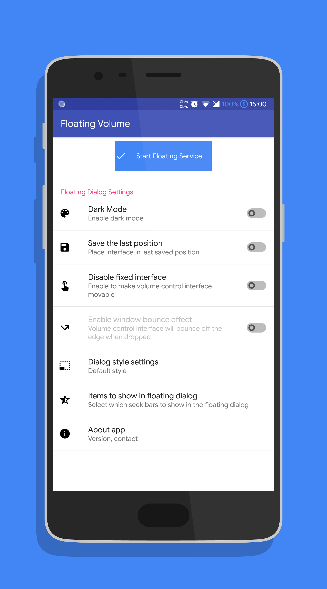
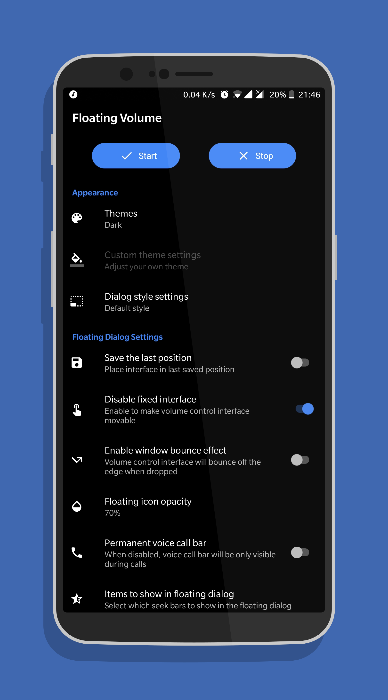
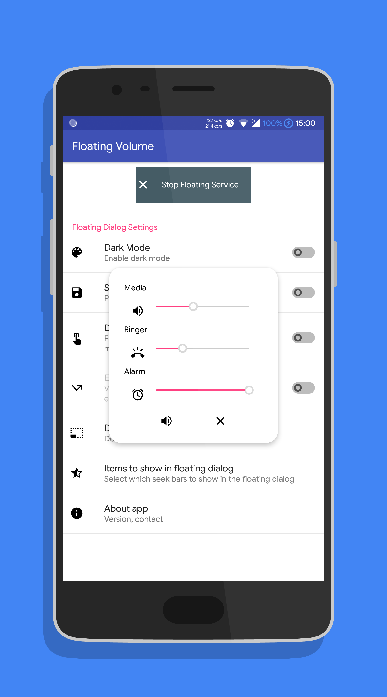
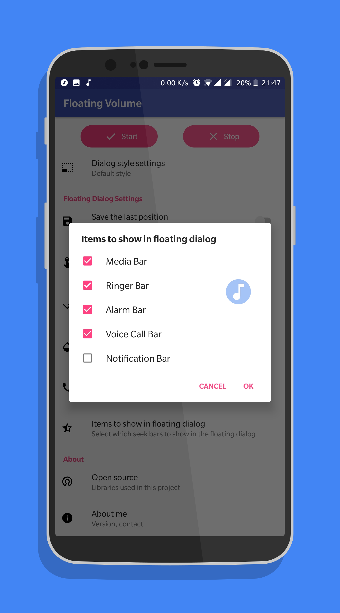
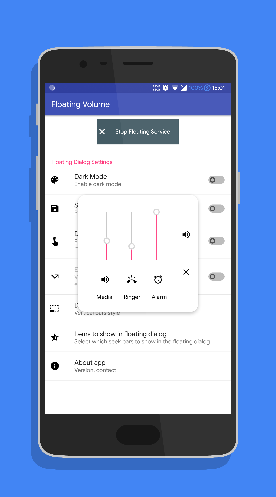
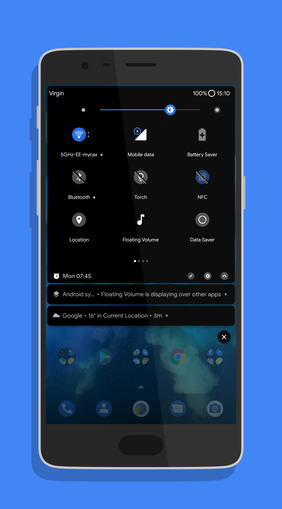
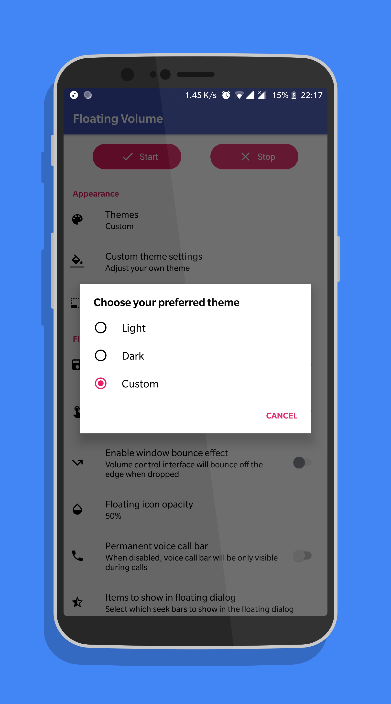
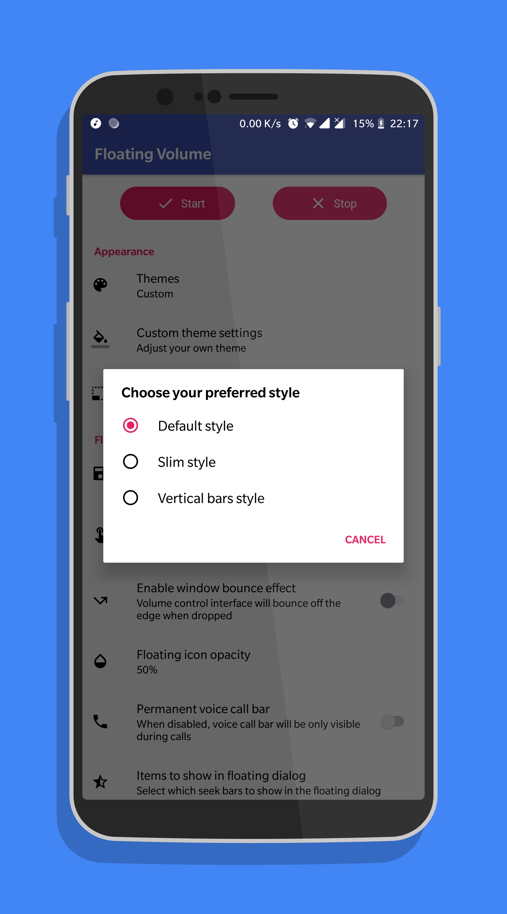
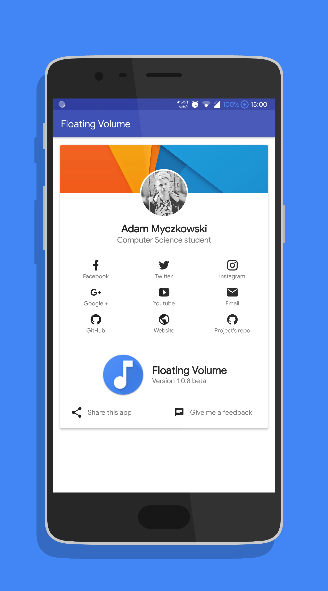
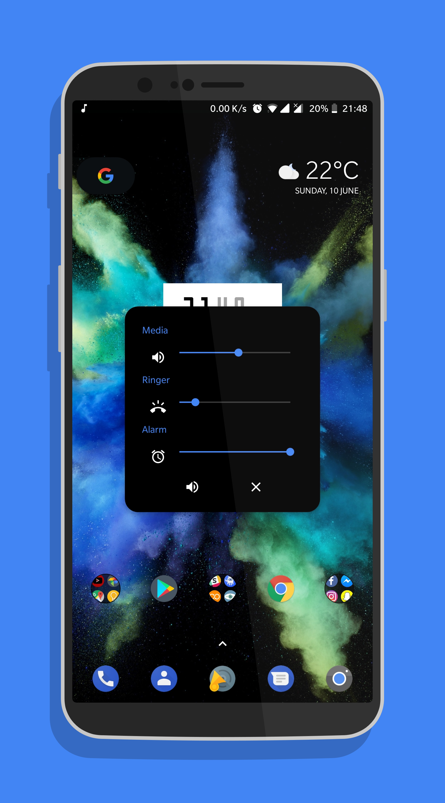

# Floating Volume
Floating Volume es una aplicación sencilla para Android 5.0+ que te permite controlar el volumen de multimedia, timbre, alarma y durante llamadas, y cambiar entre los modos de timbre directamente desde la interfaz flotante.

## Características
* Temas: Predeterminado, Oscuro y Personalizado: elige entre una variedad de colores predefinidos
* Guardar la última posición de la interfaz flotante (las posiciones del encabezado y la interfaz de volumen son independientes)
* Iniciar/detener el servicio directamente desde el elemento de ajustes rápidos
* La interfaz de control de volumen puede ser móvil o fija en el centro
* Mostrar y ocultar los controles del diálogo
* Elige entre 3 estilos de diálogo diferentes
* Cambiar la opacidad del icono

## Galería

## Nota
¡Próximamente más funciones! Se agradecen los informes de errores y las solicitudes de nuevas características.

# Licencia

    Derechos de autor 2018 Adam Myczkowski

    Licenciado bajo la Licencia Apache, Versión 2.0 (la "Licencia");
    no podrá utilizar este archivo excepto de conformidad con la Licencia.
    Puede obtener una copia de la Licencia en

       http://www.apache.org/licenses/LICENSE-2.0

    A menos que lo exija la ley aplicable o se acuerde por escrito, el software
    distribuido bajo la Licencia se distribuye en una BASE "TAL CUAL",
    SIN GARANTÍAS O CONDICIONES DE NINGÚN TIPO, expresas o implícitas.
    Consulte la Licencia para conocer el lenguaje específico que rige los permisos y
    las limitaciones de la Licencia.

# Política de Privacidad

    Esta aplicación utiliza android.permission.READ_PHONE_STATE para
    detectar llamadas y mostrar la barra de llamada de voz. No recopila
    ningún dato del usuario.
